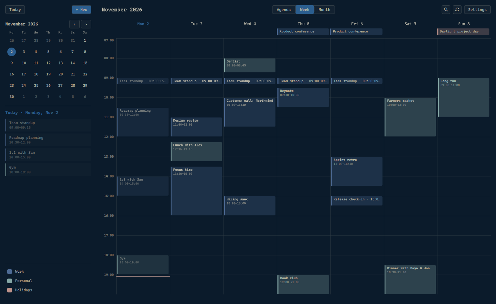

# Docket



Standalone calendar window (Quickshell) and reminder notifier for calendars synced by
vdirsyncer and read through khal. No accounts of its own: see
[Adding a calendar](#adding-a-calendar).

> **Use at your own risk.** Docket writes to your real calendars: editing and deleting rewrite
> or remove `.ics` files that vdirsyncer then syncs to Google, iCloud or your CalDAV server.
> Every edit and delete first copies the original to `~/.local/state/docket/backup/`. Search
> reads khal's internal cache database (layout version 5) and refuses to run on any other
> version. Built and tested on one Omarchy setup (khal 0.14, vdirsyncer 0.21, Quickshell 0.3).

- `docket [agenda|week|month]`: open the window, or raise it if it is already open.
  Keys: ←/→ move, `t` today, `a`/`w`/`m` views, `n` new event, `/` search, `r` sync.
  Double-click empty space in the week view to create an event at that hour.
  Meetings with a Meet/Zoom/Teams link get a Join button in the agenda and sidebar from
  15 minutes before until they end.
- Search (`/`, or `qs ipc -p qml call docket search "<text>"`) looks through titles, locations
  and notes of everything khal has, next occurrence first. It reads khal's cache database
  (`~/.cache/khal/khal.db`, layout version 5) directly, because `khal search` is too slow.
- Settings (toolbar button, or `qs ipc -p qml call docket settings [week|calendars|reminders]`):
  - Week view: hours shown in the grid.
  - Calendars: rename, hide, and color each calendar (theme palette, intense variant, or `#rrggbb`).
  - Reminders: default lead time (off / 5 / 10 / 15 / 30 min) and which calendars notify.

  All saved to `~/.config/docket/config.json`, which can also be edited by hand:
  `dayStartHour`, `dayEndHour`, `calendarColors` and `calendarNames` (`{"<calendar id>": ...}`),
  `hiddenCalendars` and `reminderCalendarsOff` (lists of calendar ids), `reminderMinutes`.
- `docket-notify`: run every minute by `docket-notify.timer`. Uses each event's own pop-up
  alerts (set on a phone or in Google) when it has any; otherwise timed events get the default
  lead time from `config.json` (10 minutes if unset) and all-day events a reminder at 09:00 that
  day. "Off" turns every reminder off. khal doesn't report sound-only alerts or ones set to an
  exact date and time, and an event set to "no alert" still gets the default.
- `docket-helper`: the JSON bridge the window uses (`events`, `calendars`, `create`, `update`,
  `delete`, `people`, `search`, `sync`).

New events (optionally repeating daily/weekly/monthly/yearly, with notes) go through
`khal new`. Events can be edited or deleted from their details popup: Docket rewrites or
removes the event's `.ics` file in `~/.calendars` (bumping `SEQUENCE`), after copying the
original to `~/.local/state/docket/backup/`. Every write then starts `vdirsyncer-sync.service`.
For a repeating event you pick **this one** (stored as an exception to the series) or **all**.
Changing all occurrences can change their time but not their day, and a repeating event can't
switch between all-day and timed. Events crossing midnight and read-only calendars are not
editable; use Google Calendar or iCloud for those. Restore a change by copying its backup back
into the calendar folder and syncing.

## Requirements

`quickshell`, `khal`, `vdirsyncer`, `python-icalendar`, `libnotify` (`notify-send`), and for
Google accounts `python-aiohttp-oauthlib`.

Docket starts syncs through a systemd user unit named `vdirsyncer-sync.service`, which is
not part of this repo. A minimal one, with a timer for the background sync:

```ini
# ~/.config/systemd/user/vdirsyncer-sync.service
[Unit]
Description=Sync calendars via vdirsyncer
[Service]
Type=oneshot
ExecStart=/usr/bin/vdirsyncer sync

# ~/.config/systemd/user/vdirsyncer-sync.timer
[Timer]
OnBootSec=2min
OnUnitActiveSec=30min
[Install]
WantedBy=timers.target
```

`systemctl --user daemon-reload && systemctl --user enable --now vdirsyncer-sync.timer`

## Install

`./install` (symlinks into `~/.local/bin`, `~/.local/share/applications`,
`~/.config/systemd/user`, enables the reminder timer).
Test: `python3 tests/test_notify.py && python3 tests/test_helper.py` (the second needs khal)

## Adding a calendar

Docket has no accounts of its own. A calendar shows up once vdirsyncer syncs it into a folder
and khal is told to read that folder. Three steps: vdirsyncer, first sync, khal.

**Keep the local folder at `~/.calendars/<account>/`.** Editing and deleting look for events
there; calendars stored elsewhere still show up but can't be edited from Docket.

### 1. vdirsyncer (`~/.config/vdirsyncer/config`)

Each account is a *pair*: a local folder (`a`) and the server (`b`). Keep passwords and
secrets out of the file: store them in the keyring and let vdirsyncer fetch them.

**iCloud** — create an app-specific password at account.apple.com (Sign-In and Security →
App-Specific Passwords; your Apple ID password won't work), then store it:

```sh
secret-tool store --label="vdirsyncer iCloud" service vdirsyncer account icloud
```

```ini
[pair icloud_calendar]
a = "icloud_local"
b = "icloud_remote"
collections = ["from b"]          # every calendar on the account; or list ids from `discover`
conflict_resolution = "b wins"

[storage icloud_local]
type = "filesystem"
path = "~/.calendars/icloud/"
fileext = ".ics"

[storage icloud_remote]
type = "caldav"
url = "https://caldav.icloud.com/"
username = "you@icloud.com"
password.fetch = ["command", "secret-tool", "lookup", "service", "vdirsyncer", "account", "icloud"]
```

Any other CalDAV server (Fastmail, Nextcloud, …) is the same with its own `url`.

**Google** — Google requires your own OAuth client (vdirsyncer can't ship one):
1. In the Google Cloud console, create a project and enable the **CalDAV API** (not the
   Calendar API).
2. Configure the OAuth consent screen, then create an **OAuth Client ID** of type
   **Desktop application**. Store the secret:
   `secret-tool store --label="vdirsyncer Google" service vdirsyncer account google_client_secret_work`
3. Choose which calendars Google offers to sync (shared ones are off by default) at
   calendar.google.com/calendar/syncselect.

```ini
[pair google_work]
a = "google_work_local"
b = "google_work_remote"
collections = ["from b"]
conflict_resolution = "b wins"

[storage google_work_local]
type = "filesystem"
path = "~/.calendars/work/"
fileext = ".ics"

[storage google_work_remote]
type = "google_calendar"
token_file = "~/.config/vdirsyncer/google_token_work.json"   # vdirsyncer creates it
client_id = "<client id>.apps.googleusercontent.com"
client_secret.fetch = ["command", "secret-tool", "lookup", "service", "vdirsyncer", "account", "google_client_secret_work"]
```

**Read-only subscription** (an `.ics` URL, e.g. sports or holidays):

```ini
[pair holidays_calendar]
a = "holidays_local"
b = "holidays_remote"
collections = null
conflict_resolution = "b wins"

[storage holidays_local]
type = "filesystem"
path = "~/.calendars/holidays/"
fileext = ".ics"

[storage holidays_remote]
type = "http"
url = "https://example.com/holidays.ics"
```

### 2. First sync

```sh
vdirsyncer discover google_work    # lists the calendars it found; Google opens a browser to authorize
vdirsyncer sync google_work
```

Afterwards each calendar is a folder such as `~/.calendars/work/you@example.com/`.

**Don't run `vdirsyncer metasync`** (or add `metadata = ["displayname"]` to a pair) on a setup
that already works. It writes each calendar's server name into a `displayname` file, and khal
then uses that name as the calendar's id instead of the folder name. Anything keyed by the old
id breaks: khal refuses to start if `default_calendar` uses it, and Docket's per-calendar
colors, names, hiding and reminder settings stop applying. Renaming the calendar on the server
later would change the id again. Give calendars readable names in Docket's Settings →
Calendars instead.

### 3. khal (`~/.config/khal/config`)

```ini
[calendars]
[[work]]                           # one section per account folder
path = ~/.calendars/work/*
type = discover                    # every calendar folder under it
color = light blue

[[holidays]]
path = ~/.calendars/holidays/
type = calendar
readonly = True                    # Docket won't offer to create or edit here
```

Check with `khal printcalendars`, then restart Docket (close the window and run `docket`):
it reads the calendar list at start. Rename, recolor, hide, or mute reminders for the new
calendar in Settings → Calendars and Settings → Reminders.

To remove a calendar, delete its sections from both files and its folder under `~/.calendars`.

## License

MIT, see `LICENSE`. `qml/CalendarModel.js` is copied from
[omarchy-caldav-calendar](https://github.com/SirWizardLizard/omarchy-caldav-calendar)
(MIT, Copyright (c) 2026 sirwizardlizard; license text in `qml/CalendarModel.js.LICENSE`).
